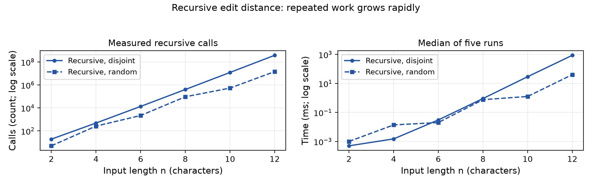
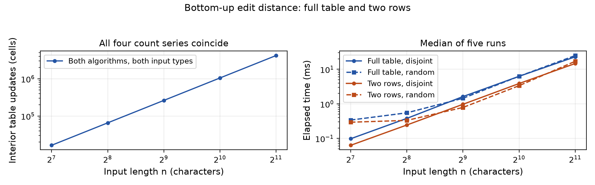
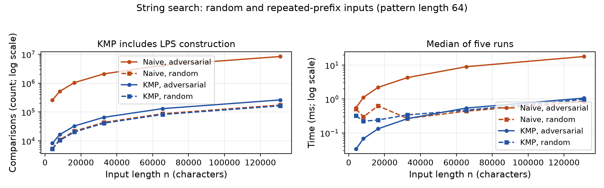

# Experiment Design Card

Recorded on 8 November 2026 before the first experiment run. Seed: 20261108.

Student: Temirgaliyev Nurassyl. Group: SE-2523.

| Field | Plan |
| --- | --- |
| Questions | Edit distance: how quickly does repeated recursion grow, and do two rows keep the full table's answers and work while reducing memory? Search: how much work does KMP save on repeated near-matches? |
| Sizes | Recursive edit distance: n = 2, 4, 6, 8, 10, 12. Full table and two rows: n = 128, 256, 512, 1024, 2048. Both edit strings have length n. Search text: n = 4096, 8192, 16384, 32768, 65536, 131072; pattern length m = 64. Each range covers at least a factor of four; recursion is capped because of exponential work. |
| Edit inputs | Random: independent strings over ABCD, to include matches and mismatches. Disjoint: a repeated n times versus b repeated n times, to force all three recursive branches at every non-base call. |
| Search inputs | Random: independent ABCD text and pattern, to show ordinary early mismatches. Adversarial: a repeated n times versus a repeated 63 times followed by b, to force 64 comparisons at each naive candidate. |
| Metrics | Record five times in milliseconds and plot their median to show practical cost while reducing the influence of outliers. Recursive calls, including base calls, expose repeated work; interior DP cell updates test quadratic growth; character comparisons expose search rechecks. Count LPS comparisons separately and add them to search comparisons for a fair total that includes KMP preprocessing. Unused counters are zero. |
| Prediction | Disjoint recursion grows exponentially and random recursion usually costs less. DP cell updates grow as n squared; two rows reduce memory, but both versions have the same cell count. Random searches use roughly linear work; adversarial naive search has a large constant of about 64 comparisons per start, while KMP uses linear work with a much smaller constant. With m fixed, both curves are linear in n; this experiment does not establish quadratic growth for naive search. |
| Plots | (1) Recursive calls and median time versus n, with log y axes: how quickly does recursion become impractical? (2) DP updates and median time versus n, with log axes: does doubling n quadruple work, and how do the versions compare? (3) Total search comparisons and median time versus text length: which input exposes KMP's savings? Each chart has a one-sentence takeaway. |
| Procedure | Generate inputs outside timing with a custom generator using fixed-seed java.util.Random, a separate seed per size and input type, and shared strings for competing algorithms. Perform three unmeasured warmups per case, then five measured calls. Time the whole public call with System.nanoTime, including counters, KMP preprocessing and match-list creation. Exclude generation, validation and file writing. Validate answers outside timing. Save one CSV row per measured call. |
| Reproduction | The command reproduces inputs, results and counts exactly; clock times vary. No experiment design changed. After measurement, letter notation was corrected to lowercase a/b to match the generator, and metric reasons and plot questions were made explicit to clarify the original plan. |

# Edit Distance: Design and Results

The code is comment-free as requested. The state, transition and base case for each version are documented here instead of source comments.

**Recursive.** State: D(i,j) is the distance between the first i characters of a and first j of b. Transition: equal last characters give D(i-1,j-1); otherwise use 1 + min(D(i-1,j), D(i,j-1), D(i-1,j-1)), without storing answers. Base case: D(0,j)=j and D(i,0)=i.

**Full table.** State: dp[i][j] stores D(i,j). Transition: fill rows left to right using the same diagonal/mismatch recurrence. Base case: initialize dp[0][j]=j and dp[i][0]=i.

**Two rows.** State: previous[j]=D(i-1,j), current[j]=D(i,j). Transition: use previous[j], current[j-1] and previous[j-1], then swap rows. Base case: initialize previous[j]=j and start every new row with current[0]=i.

*Figure 1. Disjoint inputs grow from 19 calls at n=2 to 377,393,953 calls at n=12, showing how quickly repeated recursion becomes expensive.*

*Figure 2. Both implementations update exactly n squared interior cells, while two rows have lower median times at every tested size on both input types.*

At n=2048 both DP versions update 4,194,304 cells. Random-input medians are 24.9799 ms for the table and 17.0403 ms for two rows; disjoint-input medians are 22.9519 ms and 14.6885 ms. The full table stores 4,198,401 integers versus 4,098 in two rows: about 16.0 MiB versus 16.0 KiB of integer payload, excluding Java object overhead. These storage figures are calculated from array sizes, not measured memory usage.

# String Search and Predictions

Naive search compares the pattern at each possible start. KMP first builds lps[j], the longest proper prefix of the pattern that is also a suffix ending at j. After a mismatch it moves the pattern index to lps[j-1], preserving an already matched prefix while the text index never decreases. After a full match it uses the same fallback to find overlaps. Its running time is O(n+m), versus naive search's O((n-m+1)m) worst case; both also store their returned matches.

*Figure 3. At n=131072, the repeated-prefix input makes naive search use about 32 times as many comparisons as KMP, including LPS construction.*

The following rows summarize the largest search input. Times are medians of five runs; the comparison column includes LPS work.

| Algorithm | Input | Comparisons | Time (ms) |
| --- | --- | ---: | ---: |
| Naive | Random | 174,576 | 0.8445 |
| KMP | Random | 163,901 | 0.9774 |
| Naive | Adversarial | 8,384,576 | 17.9537 |
| KMP | Adversarial | 262,206 | 1.0665 |

## Prediction versus result: edit distance

As predicted, disjoint recursion grows rapidly: going from n=10 to n=12 multiplies calls by about 31.1. Random n=12 needs 14,341,700 calls, much less than the disjoint case because equal characters remove two branches. Doubling n multiplies DP cell updates by exactly four on both inputs, confirming the quadratic work prediction. Two rows preserve every answer and cell count; their observed timing advantage is consistent with smaller allocations and better locality, although this experiment does not isolate those causes.

## Prediction versus result: search

The adversarial case matches the prediction: naive search repeats 64 comparisons per candidate, while KMP reuses the matched prefix. At the largest size, KMP's total is 262,081 search comparisons plus 125 LPS comparisons; the median is about 16.8 times faster than naive search. Random inputs give similar comparison counts, but KMP is slightly slower at the largest size despite fewer comparisons, showing that control flow and overhead matter too. Pattern length stays 64, so both adversarial curves are linear in text length; varying m would be needed to demonstrate the full O(nm) dependence. All generated search cases have zero matches, so timing conclusions concern unsuccessful searches; overlap and successful searches are covered by tests.

# Short Answers and Timing

## Which input made string search slowest, and why?

The slowest search was naive search on the adversarial n=131072 input, with a 17.9537 ms median. The text contains only a, while the pattern has 63 a characters followed by b. Each candidate passes 63 comparisons and fails on the last character, repeating almost the entire work at the next position. KMP reuses prefix information, reducing this case from 8,384,576 to 262,206 total comparisons.

## How large an n could recursive edit distance handle?

The largest tested length was n=12 for each string. Disjoint strings took a median of 868.8554 ms and 377,393,953 recursive calls, compared with 40.3281 ms and 14,341,700 calls for random strings. I stopped at the planned cap because exponential repeated work was already clear and larger disjoint inputs would make repeated measurements expensive. This is a practical experiment limit, not a measured maximum or a crash boundary; stack overflow was not encountered.

## What do two rows gain and lose?

Two rows reduce extra storage from O(nm) to O(m), preserving the distance and the O(nm) running time. For n=m=2048, the integer payload falls from about 16.0 MiB to 16.0 KiB, and all answers agree. Previous rows are discarded, so a simple traceback through the full table is unavailable when reconstructing an edit sequence. Recovering that sequence would need extra computation or a different reconstruction method.

## Which search would you choose for the city platform?

I would choose KMP for exact pattern matching in long city log files because its O(n+m) work remains predictable on repeated text. It finds every occurrence, including overlaps, and the adversarial experiment shows a large saving. Naive search is simpler and can be competitive on random short patterns, so KMP is not guaranteed to have the lowest time on every input. For typo suggestions in the search box, I would use two-row edit distance separately, since KMP only finds exact matches.

## What the measured times mean

The 280 recorded runs used OpenJDK 25 on Windows 11, amd64, with 16 available processors. Five measured runs followed three warmups per case; all elapsed times were positive, ranging from fractions of a millisecond to nearly a second. Some small-input medians are irregular: random naive search falls from 0.5039 ms at n=4096 to 0.2987 ms at n=8192, even though comparisons increase. JVM compilation, allocation, scheduling and timer overhead can affect these short calls; three warmups do not guarantee steady-state execution. Algorithms also run in a fixed order, so timing ratios are descriptive rather than a controlled microbenchmark. Counters give a deterministic record of work and support the growth conclusions when timings are noisy.

## Validation

All 10 JUnit 5 tests pass, with zero failures, errors or skipped tests. They include every supplied reference, both empty edit inputs, 100 random edit pairs, 100 random search cases checked against an independent indexOf reference, overlapping matches, empty-pattern exceptions, longer patterns, 100 LPS definition checks, and counter resets. The experiment also checks agreement outside each timed call. Every case has five CSV rows; a second execution reproduced all 280 rows exactly except elapsed time, confirming that inputs, answers and operation counts are reproducible.
